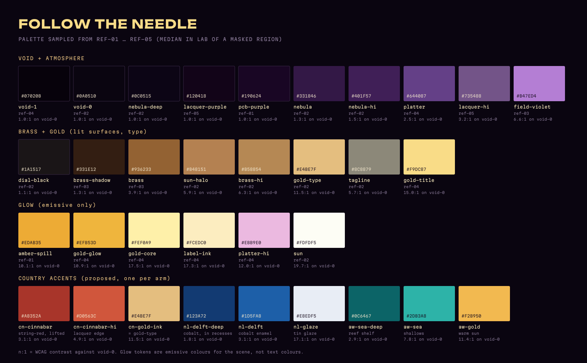
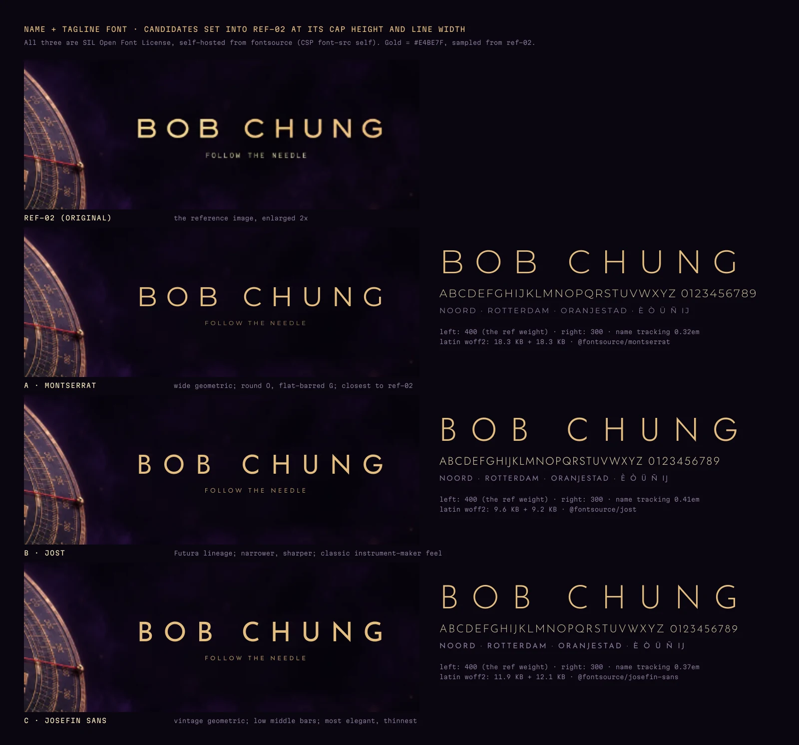
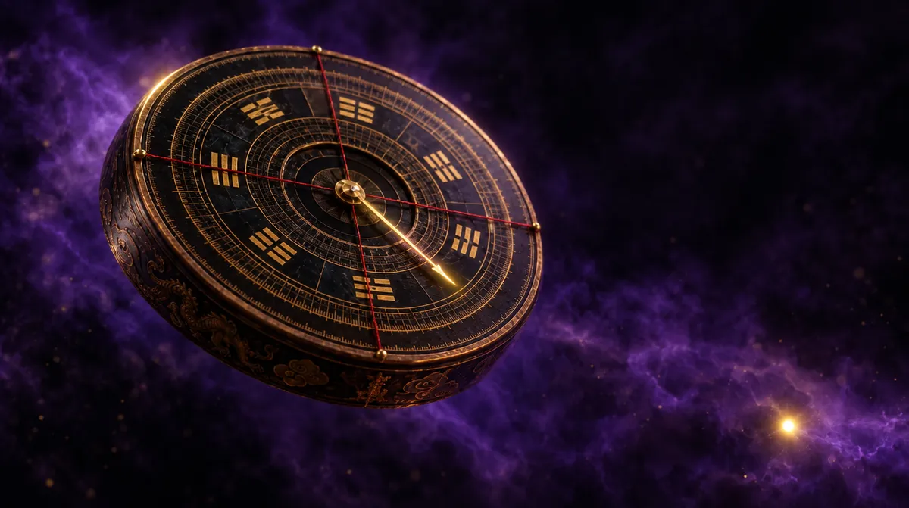

# Art direction: Follow the Needle

Milestone 1, 2026-10-20. Covers brief §0.2, §2, §3, §4 and §11 (`MASTER-PROMPT-v2.md`).
Everything below is a starting value for M2–M6. A value changes when a screenshot proves it wrong, and the change is written here.

Files beside this doc (`docs/art-direction/`):

| File | What it is |
| --- | --- |
| `palette.png` | the swatch board for §1 |
| `palette.json` | every sampled token with its image, region and pixel count, plus the 7 dominant colours of each reference |
| `name-font-sample.webp` | the three name-font candidates set into ref-02 (§4) |
| `m1-test-hero-plate-01.webp` | the Higgsfield test plate, downsized (§7); the full PNG is `assets/raw/` |
| `tools/*.mjs` | the scripts that made all of the above (they need `sharp`, `opentype.js` and the `@fontsource` packages; they are not wired into the build) |

---

## 1. Palette

**Method.** `tools/palette.mjs` reads each reference with `sharp` and samples a named region. A hue/saturation/value mask keeps only the pixels of the material in question (for example "gold pixels inside the BOB CHUNG box"). The token is then the per-channel median in CIE Lab of those pixels. Glow tokens take the median of the brightest 2–30 % instead, because a glow is defined by its hot end. Regions are drawn on `debug-*.png` overlays when the script runs.

**What the frames are made of** (7-colour k-means in Lab over each whole image):

| Ref | near-black + void | purple | brass / bronze | gold glow |
| --- | --- | --- | --- | --- |
| ref-01 chip | `#140c16` 35 % | `#230c34` 24 %, `#431d66` 7 % | `#402538` 16 %, `#5d362e` 10 %, `#a17159` 6 % | `#e3a53b` 3 % |
| ref-02 hero | `#0d0712` 51 % | `#190b26` 20 %, `#311745` 13 % | `#301f1d` 7 %, `#6f4a3b` 4 % | `#d5ae7a` 1 % |
| ref-03 morph | `#14090e` 34 % | `#241224` 18 %, `#4a2152` 5 % | `#44281e` 21 %, `#825132` 12 % | `#dba566` 6 % |
| ref-04 platter | `#0c040c` 35 % | `#1f0e2c` 25 %, `#351857` 17 %, `#6f42aa` 7 % | `#462827` 9 %, `#9b623a` 4 % | `#f1c56b` 4 % |
| ref-05 abacus | `#0f0712` 41 % | `#190d23` 32 %, `#2f1a40` 12 % | `#4c2b26` 7 %, `#9e6838` 3 % | `#f0c35a` 3 % |

**Rule that falls out of it: about 60 % near-black, 30 % purple, at most 6 % gold.** Gold is precious in every frame. If a screenshot shows more gold than that, something is lit that should not be.

### Tokens

CSS custom properties use these names; the scene reads the same values through the ported engine `palette` module.

**Void and atmosphere**

| Token | Hex | Sampled from | Use |
| --- | --- | --- | --- |
| `--void` | `#0a0510` | ref-02, the empty sky right of the name | page background, canvas clear colour |
| `--void-deep` | `#07020b` | ref-04, shadowed chassis | vignette target, deepest shadows |
| `--nebula-deep` | `#0c0515` | ref-02, nebula body lower left | fog colour |
| `--nebula` | `#331846` | ref-02, lit wisps under the compass (top 15 %) | haze sprites, fill light |
| `--nebula-hi` | `#401f57` | ref-02, brightest wisps (top 2 %) | haze highlights; nothing in the atmosphere is brighter |
| `--field-violet` | `#b47ed4` | ref-03, magnetic field lines | the only bright purple: field lines, platter rim light (emissive) |
| `--pcb` | `#190624` | ref-01, solder mask | loader board |
| `--lacquer` / `--lacquer-hi` | `#120418` / `#735488` | ref-05, abacus beads (median / lit side) | Funcial abacus |
| `--platter-tint` / `--platter-hi` | `#644087` / `#ebb9e0` | ref-04, spindle and platter (median / specular) | look-dev check for the platter's reflections, not an albedo (§3) |

**Brass, gold and type**

| Token | Hex | Sampled from | Use |
| --- | --- | --- | --- |
| `--dial` | `#1a1517` | ref-02, dial face between engravings | black lacquer of the heaven plate |
| `--brass-shadow` | `#331e12` | ref-03, compass body in shadow | engraving cavities, AO tint |
| `--brass` | `#936233` | ref-03, compass body lit | brass albedo |
| `--brass-hi` | `#b58854` | ref-02, rim and engraving highlights (top 8 %) | brass F0 / specular colour |
| `--gold-ink` | `#e4be7f` | ref-02, the BOB CHUNG letterforms | name, tagline, gold leaf in engravings (11.5:1 on `--void`) |
| `--gold-title` | `#f9dc87` | ref-04, the FUNCIAL title | heavy project titles (15.0:1) |
| `--ink` | `#fcedc0` | ref-04, TP caption text | labels and reading text (17.3:1) |
| `--ink-dim` | `#8c8879` | ref-02, the FOLLOW THE NEEDLE letterforms | secondary text, hints (5.7:1, passes AA for small text) |
| `--string-red` | `#7a2126` | ref-02, red sighting strings | the two silk strings only |

**Glow (emissive colours for the scene, never text)**

| Token | Hex | Sampled from | Use |
| --- | --- | --- | --- |
| `--amber-spill` | `#edab35` | ref-01, light under the probed chip | loader under-glow |
| `--gold-glow` | `#efb53d` | ref-04, track glow | the south-arm track, test-point beads |
| `--gold-core` | `#fef0a9` | ref-04, hottest part of the track (top 20 %) | track core, bead centres |
| `--sun` / `--sun-halo` | `#fdfdf5` / `#b48151` | ref-02, the distant sun | the sun sprite core and halo |

### Country accents (proposed, §5)

One accent per arm. Each accent lives only on its arm (inlay, bezel segment, nearby ticks), on its light wash and on its own page. Purple and gold stay dominant everywhere else. Hues are LCh angles; the nebula sits at 315°.

| Arm | Token | Hex | Why | Text on `--void`? |
| --- | --- | --- | --- | --- |
| East · China | `--cn-cinnabar` | `#a8352a` | carved cinnabar lacquer; the sampled `--string-red` lifted to lacquer lightness (hue 35°, same family as the strings) | no (3.1:1) |
| | `--cn-cinnabar-hi` | `#d0563c` | lacquer edge catching the key light | large text only (4.9:1) |
| | `--cn-gold-ink` | `#e4be7f` | gold ink on lacquer = `--gold-ink` | yes |
| North · Netherlands | `--nl-delft-deep` | `#123a72` | cobalt pooled in the recesses | no |
| | `--nl-delft` | `#1d5fa8` | cobalt enamel; hue 279°, 36° away from the nebula so it reads as blue, not as haze | no (3.1:1) |
| | `--nl-glaze` | `#e8edf5` | tin-glaze white for the painted line work | yes (17.1:1) |
| West · Aruba | `--aw-sea-deep` | `#0c6467` | reef shelf, enamel at depth | no |
| | `--aw-sea` | `#2db3a8` | shallow-water turquoise, hue 187° | yes (7.8:1) |
| | `--aw-gold` | `#f2b950` | warm sun on sand; warmer and lighter than `--gold-glow` so Aruba's gold is not the portal's gold | yes (11.4:1) |
| South · portal | — | gold only | `--gold-glow` + `--gold-core`, the brightest arm | — |

The Delft blue was first `#2a4ea3`. It sat only 25° from the nebula and would have blurred into the haze, so it moved toward cobalt.

---

## 2. Lighting rig

Units: the compass diameter is **1.0**. All distances below are in compass diameters (D).

| Light | Type | Colour | Start value | Placement | Job |
| --- | --- | --- | --- | --- | --- |
| Key | `DirectionalLight` (shadow on high tier only, 1024², radius 4) | `--ink` `#fcedc0` | 2.4 | upper left, in front: azimuth −35°, elevation 42° | the warm gold side of every brass face (ref-02 dial, ref-03 body) |
| Rim | `SpotLight`, angle 18°, penumbra 0.8 | `--gold-ink` `#e4be7f` | 6 | behind right, high: azimuth 150°, elevation 30°, 3 D away | the hairline specular on the bezel and needle edges |
| Fill | `HemisphereLight` | sky `--nebula` `#331846`, ground `--void-deep` `#07020b` | 0.45 | — | purple bounce from the nebula into the shadows; never lifts black above `--dial` |
| Sun | emissive sprite + a weak `DirectionalLight` | core `--sun`, halo `--sun-halo`; light `#f2b950` | sprite HDR 8; light 0.35 | screen position 86 % × 87 % in the hero frame (ref-02 x 722/836, y 401/463), 40 D away | the only distant light; a faint warm kiss on the lower rim. It is also an easter egg (§11) |
| Track | emissive mesh, no light | `--gold-glow` / `--gold-core` | HDR 3–6 | on the platter / south arm | the brightest thing on screen from M4 on (§6 Part 3) |

**Reflections: a PMREM light-card room, no CDN presets.** `<Environment preset>` is banned (CSP and the plan's unit test). Instead, one small scene is built once, run through `PMREMGenerator.fromScene(room, 0.04)`, assigned to `scene.environment`, and the room is disposed:

| Card | Size (room = 10 units cube, walls `--void-deep`) | Emissive colour × intensity | What it shows up as |
| --- | --- | --- | --- |
| softbox | 4 × 3, upper left front | `#fcedc0` × 4 | the broad warm sheen on brass and lacquer |
| strip | 0.4 × 6, right, vertical | `#e4be7f` × 6 | the long streak along a turned rim (ref-02, ref-03) |
| floor | 8 × 8, below | `#331846` × 1.5 | purple in the platter mirror (ref-04) |
| sun dot | 0.3 × 0.3, low right | `#fdfdf5` × 12 | one tiny hot glint |

256 px cube faces are enough; this is a few kilobytes of GPU work and nothing to download. The same room can be rebuilt with drei `<Environment>` + `<Lightformer>` children (no `preset`, no `files`).

**Fog and haze.**
- `FogExp2`, colour `--nebula-deep` `#0c0515`. Density = 0.83 / (distance at which an object keeps half its colour). Start: half at 6 D → density ≈ 0.14 per D. In the void (M5) half at 40 D → ≈ 0.021.
- Volumetric haze: the ported `studio/Haze` sprites tinted `--nebula`, additive, depth-faded, 3 layers at 2, 5 and 9 D behind the subject.
- Dust: instanced points, `--gold-glow` at 25 % alpha, 1–2 px, slow drift. On low tier only 30 % of the count. Dust exists because the references have it, and it is the only "particle" without a part or project behind it (§1 rule): it shows that the camera has a macro lens.

**Post chain (pmndrs `@react-three/postprocessing`, never `three/addons` EffectComposer).** The order is fixed: DoF → Bloom → Vignette → Noise → tone mapping last.

| Effect | Start values | Tier |
| --- | --- | --- |
| `DepthOfField` | world focus on the needle pivot; focal length 0.03; bokeh scale 3 (hero) → 5 (macro project focus) | high only; a focus pull takes 0.6–0.9 s and lands 0.2 s before the camera move ends |
| `Bloom` (mipmap blur) | luminance threshold **1.0** in linear HDR, smoothing 0.12, intensity 0.7, radius 0.6 | high: full res; medium: half res, intensity 0.5; low: off |
| `Vignette` | offset 0.3, darkness 0.65 | all tiers (low: a CSS radial gradient over the canvas instead of a pass) |
| `Noise` | opacity 0.03, premultiply on | high + medium |
| `ToneMapping` | the ported `ShoulderToneMapping` (revision 4 shoulder GLSL), exposure 1.0; renderer `toneMapping = NoToneMapping` so it is applied once | all tiers; low tier keeps the ShaderChunk patch from the plan |

**The bloom threshold of 1.0 is the art direction:** only emissive tokens (track, beads, sun, amber spill, field lines) go above 1.0, so only they glow. A brass specular that blooms means the key or a light card is too hot.

---

## 3. Materials

All `MeshPhysicalMaterial` unless noted. Engraving, dial text, degree ticks, 東南西北 and the eight trigrams are procedural: SVG → canvas → albedo, roughness, normal and AO masks (the ported `instrument/paint` and `textures` code, glyph outlines from `tools/glyphs.mjs`). No AI image is ever used as a texture with characters on it.

| Material | Colour | Metalness / roughness | Extras | Notes |
| --- | --- | --- | --- | --- |
| **Antique brass** (rim, rings, housing) | albedo `--brass` `#936233`, varied by low-frequency noise toward `--brass-shadow` and `--brass-hi` | 1.0 / 0.34 (engraved grooves 0.6) | anisotropy 0.3 along the circumference for turned rings; AO from the engraving mask tinted `--brass-shadow` | dragon relief on the rim = normal + AO from a procedural height map, not a sculpt |
| **Dial lacquer** (heaven plate face) | `--dial` `#1a1517` | 0 / 0.3 | clearcoat 1, clearcoat roughness 0.08 | gold-ink fill in the engraving is a metal mask: metalness 1, colour `--gold-ink`, roughness 0.25 |
| **Needle** | `--gold-ink` `#e4be7f` | 1.0 / 0.18 | emissive `--gold-glow` × 0.15 so it reads on black | the south tip carries the portal: emissive × 0.6 and a pulse on hover |
| **Red silk strings** | `--string-red` `#7a2126` | 0 / 0.8 | sheen 0.5, sheen colour `--cn-cinnabar` | tubes 0.003 D thick; they catch the rim light, nothing else |
| **Red lacquer** (China arm) | `--cn-cinnabar` `#a8352a`, recesses `#5a1a16` | 0 / 0.35 | clearcoat 1, clearcoat roughness 0.12 | carved-lacquer look = AO depth + gold-ink lines as a metal mask |
| **Enamel inlays** (Delft, Aruba) | Delft `--nl-delft` → `--nl-delft-deep` at depth, glaze lines `--nl-glaze`; Aruba `--aw-sea` → `--aw-sea-deep` at depth | 0 / 0.12 | clearcoat 1, clearcoat roughness 0.05, ior 1.5 | champlevé: the enamel sits in cells between thin brass walls; colour darkens with cell depth |
| **Platter mirror** | near-neutral silver `#c9c3d6` | 1.0 / 0.05 | anisotropy 0.8, tangent along the circumference (brushed concentric), env intensity 1.2 | the purple in ref-04 is the floor light card in the reflection, not paint: check against `--platter-tint` and `--platter-hi` |
| **Track** (south arm → platter) | emissive `--gold-glow`, core `--gold-core` | `MeshBasicMaterial`, additive, tone-mapped | HDR 3–6; dashed "chain" pattern from ref-04 as a scrolling UV mask | it draws itself on project focus (§7) |
| **Glass crystal** | tint `--ink` at 4 % | — | high: drei `MeshTransmissionMaterial`, thickness 0.02, ior 1.5, roughness 0.02, chromatic aberration 0.02, samples 4, resolution 512, backside off. Medium: `MeshPhysicalMaterial` transmission 1, no MTM. Low and mobile: a fresnel-only additive shell (6 % face-on, 40 % at grazing) | the most expensive material on screen; its cost is checked in every FPS run |
| **PCB purple** (loader board, ref-01) | solder mask `--pcb` `#190624` | 0 / 0.45 | clearcoat 0.6, clearcoat roughness 0.25; raised traces in the normal map | pads and the probe tip: ENIG gold, `--gold-ink`, metalness 1, roughness 0.25 |
| **Chip package** | `#140c16` (ref-01 dominant) | 0 / 0.7 | the BC-2006 mark is laser-etched: a roughness 0.4 + albedo +8 % mask set from Martian Mono outlines | amber spill under it = emissive `--amber-spill` card, HDR 2 |
| **Abacus lacquer** (Funcial, M5) | `--lacquer` `#120418`, lit side `--lacquer-hi` | 0 / 0.3 | clearcoat 1, clearcoat roughness 0.1; gold fleck mask | lit beads switch to emissive `--gold-glow` |

---

## 4. Type

All three families are SIL Open Font License 1.1, self-hosted from fontsource (`font-src 'self'`), latin + latin-ext subsets only. Dutch and Papiamento diacritics (è ò ü ñ, IJ) are covered. No CJK webfont is loaded: 東 南 西 北 and the trigrams are engraved geometry, never type.

| Role | Family | Weight | Tracking | Size | Colour |
| --- | --- | --- | --- | --- | --- |
| Name (BOB CHUNG) | **Montserrat** (`@fontsource-variable/montserrat` 5.3.0), Bob's pick on 2026-10-20 | 300 (variable, so 300–400 can be tuned on screen) | 0.32em | `clamp(28px, 4.2vw, 64px)` cap height ≈ 0.7 × size | `--gold-ink` |
| Tagline | Montserrat | 400 | 0.36em | 11–13 px | `--gold-ink` at 75 % |
| Heavy titles (FUNCIAL, country names on their pages) | **Unbounded** (`@fontsource-variable/unbounded`, already a dependency) | 700–800 | 0.02em | `clamp(40px, 6vw, 96px)` | `--gold-title` |
| Technical labels (`01 — SECURE ELEMENT`, TP pins, HUD, `%`, `0/N`) | **Martian Mono** (`@fontsource-variable/martian-mono`, already a dependency) | 300–400, width axis 100 | 0.12–0.2em, uppercase | 11 px minimum (10 px only on the engraved chip) | `--ink` or `--ink-dim` |
| Reading text (country pages, Lite) | Montserrat | 400 | 0 | 17–19 px, line height 1.55 | `--ink` |

Using Montserrat for reading text keeps the site at three families. Bob had no preference for a separate body face (2026-10-20), so Montserrat stays.

**Name-font comparison.** Ref-02's name is a light, wide geometric sans with round O, C and G. Three fontsource candidates were set into ref-02 at its cap height and line width. On the left they are at 400, the weight the reference shows at that small size; on the right they are 300, the weight a large hero name would use:

| | Family | Character | Name tracking at ref width | Latin woff2 (300 + 400) |
| --- | --- | --- | --- | --- |
| **A, chosen** | Montserrat | widest; round O, flat-barred G; the closest match to ref-02 | 0.32em | 18.3 + 18.3 KB |
| B | Jost | Futura lineage; narrower and sharper; an instrument-maker feel | 0.41em | 9.6 + 9.2 KB |
| C | Josefin Sans | vintage geometric with low middle bars; the most elegant and the thinnest | 0.37em | 11.9 + 12.1 KB |

**Bob chose A, Montserrat, on 2026-10-20.** The variable package is used: its latin file holds every weight in 38 KB, about the same as the two static weights together. fontsource's `unicode-range` split loads the 70 KB latin-ext file only if a page uses a character outside latin.

Ref-02's tagline is set in a mono. The brief puts the tagline in the name family; Martian Mono stays the fallback if the tagline looks too soft at 11 px.

**Loading.** Preload only Montserrat's latin woff2 (38 KB) so the hero never swaps its name. Everything else is `font-display: swap`. `@fontsource-variable/montserrat` is not a dependency yet: the session that owns `package.json` adds it.

---

## 5. Motion

### What the six reference sites do (studied in the browser on 2026-10-20)

Numbers come from the sites' own CSS (`getComputedStyle`) and scripts, or from frame-by-frame screenshots where the code was not readable. Cookie banners were declined (fixchocolatier: only strictly necessary cookies). Nothing was signed in to.

| Site | Loader | Scroll | Camera | Easing and durations | What we take |
| --- | --- | --- | --- | --- | --- |
| **amix-design.com/tl/web-g-threejs** (three r185, ES modules) | "READY", a hairline progress bar, then two buttons: INSERT COIN (sound) and 音なしで入る (enter without sound); fades out over 0.6 s | native page scroll (≈ 23 000 px at a 768 px viewport) over a fixed canvas; scroll is mapped to a route parameter that lerps camera position and look target between authored nodes along an arcade street; cabinets alternate left and right | exponential follow: position `1 − e^(−3.4·dt)` (1.7 during the intro), look `1 − e^(−2.0·dt)`, so the gaze lags the body like a camera operator; pointer parallax `e^(−4·dt)`. A section jump ("warp"): 0.6 s scan-line sweep down, 1.5 s travel on a low arc (height `sin(πk)·min(22, 0.06·dist)`), 0.7 s sweep up; mid-flight it looks along the travel direction and blends to the target near both ends. Entering a cabinet dives along the screen's normal | smoothstep for the warp; UI 0.2–0.5 s `ease`; dive shroud 0.34 s ease-in; `FogExp2(#05060e, 0.026)`, ACES | the look-lags-position damping pair; the sweep → arc → settle choreography for our category jumps; "enter without sound" as the main button; a 3D ON toggle in the header; a card only while its object is centred; Esc closes; `prefers-reduced-motion` honoured |
| **shelbykho.com** (Framer) | an illustrated camera, one sentence ("Getting Shelby's desk ready."), a progress bar, about 2 s | the desk shrinks into a framed card and the scroll pushes into the journal that holds the projects; projects numbered "Project 1: Design-focused · 2026" with tag pills | 2D; a scroll-framed zoom | tactile overshoot `cubic-bezier(0.34, 1.56, 0.64, 1)` at 0.26–0.4 s on press and hover; page flip 0.38 s `cubic-bezier(0.22, 1, 0.36, 1)`; scroll cue loops at 1.9 s; the mascot blinks in `steps(1)` | the numbered list `01 · CATEGORY · YEAR`; overshoot only on small tactile UI (pins popping onto the track), never on the camera; a **Reset** for anything the visitor can disturb (spun needle, exploded parts); personality in the one loader caption. Not the flat look |
| **kinoria.studio** (three r185, Vite) | black, then a viewfinder readout (frame corners, focus bracket, meter scale, f 2.8, 1/60) over a blurred scene; when loading ends, the scene **racks focus** from blur to sharp | no page scroll (document height = viewport); the wheel drives a virtual timeline. The first scroll turns the hero into a printed photo with a paper border that tilts and falls away: the scene becomes the object | slow push on the camera body | reveals: opacity + blur + transform over **1.4 s `cubic-bezier(0.165, 0.84, 0.44, 1)`** (ease-out quart); UI 0.26–0.45 s | our loader resolves with a real DoF rack focus (blur → sharp, 1.4 s ease-out quart) instead of a fade; poster first: an 80 KB proxy plate, then the 791 KB plate, then the 5 MB GLB; a separate Lite bundle. Its total (≈ 12.6 MB) is far over our 5 MB, so we take the order, not the weight. Its "roll did not load" failure state could not be triggered; ours is THE NEEDLE LOST NORTH |
| **portfolio-zxc.com** (three r185) | scrambled "loading scene" text that decodes, a hairline and a %; then an entry gate (clock faces, ENTER / PORTFOLIO, "enter without music", a controls hint) that breathes on a 6 s ease-in-out loop | none; a free orbit | left drag rotates, right drag pans, the wheel zooms, all damped; "click table to view projects" | HUD panels 0.35 s `cubic-bezier(0.16, 1, 0.3, 1)` (ease-out expo); fades 0.5–1 s | the **INTERACTIONS 0/12** counter, small, top left, with a "last interaction" line; a clamped orbit on the hero compass (drag spin is the ported `FreeTurn`); ease-out expo for HUD panels. Its 18.7 MB (a 9.9 MB GLB) is the warning |
| **aengel.io** (Next.js, three r184 WebGPU, Lenis) | refuses a 4:3 window ("window size not supported … switch to the Lite version"); at 16:9 a 0 → 100 counter (≈ 5 s) with "fetching assets" and a hairline beside a **static poster card** of the 3D hero, then "enter in the experience" | Lenis on native scroll (≈ 26 000 px); a stone arch **disassembles brick by brick, scrubbed by scroll**, and the camera passes through it | fade from black over 2–3 s into a dim archway with god rays | text beats split per letter | the scrubbed disassembly is exactly our dissect: staggered, reversible, scroll-owned; short beats; a Lite link always visible, bottom left; the poster before WebGL. We do not refuse any window size |
| **fixchocolatier.com** (WebGL + video) | a plain % on brand brown, about 6 s, no caption | no page scroll; the hero is a pre-rendered 2160p chocolate-pour video behind the wordmark; then the wheel **steps** a curved carousel of bars, the centred bar turning to the camera, its name lit in gold in a ticker below | the carousel turns with a damped settle per step | product videos prefetched at 1080p and 1440p | pre-rendered video only for the one shot live 3D cannot match (our A03 morph), scrubbed from an all-keyframe encode, ≤ 3 MB on mobile, never 1440p+; poster frames; in PROJECT_FOCUS the wheel steps between items instead of free-scrolling |

### Our motion rules

1. **One camera, no cuts.** The camera always damps toward a target: position `k = 1 − e^(−3.4·dt)` (time constant ≈ 0.3 s), look target `k = 1 − e^(−2.0·dt)` (≈ 0.5 s). Pointer parallax: ±1.5° yaw, ±1° pitch, `e^(−4·dt)`. Use maath `damp`/`damp3` and quaternions.
2. **Shots are data:** `{position, target, fov, roll, dofFocusDistance, duration, ease}`. A new transition kills the running tween first.
3. **Country click:** an arc + dolly + roll ≤ 4°, **1.4 s** (brief range 1.2–1.8 s), ease-in-out cubic `cubic-bezier(0.65, 0, 0.35, 1)`. The DoF pull lands 0.2 s before the move ends, then the info card rises (0.35 s ease-out expo).
4. **Category jump in the void** (amix's warp, shortened): 0.4 s dim of the other clusters → 1.2 s low arc looking along the path → 0.4 s settle. Total 2.0 s.
5. **Virtual scroll:** wheel `targetProgress` damps with τ 0.12 s (crisp), touch inertia with τ 0.35 s. The dissect gives each of the 11 parts its own `smoothstep` window 0.18 wide, offset 0.06 per part; every window runs backward as well.
6. **Needle:** the ported `AngleSpring`. Hover swing: damping ratio 0.55 (≈ 12 % overshoot), settles in about 0.8 s. Idle settling "like a real needle": damping ratio 0.25 at a lower stiffness, so it swings twice and comes to rest within about 2.5 s.
7. **Easing vocabulary.** Nothing else is used.
   - Reveals: ease-out quart `cubic-bezier(0.165, 0.84, 0.44, 1)`, 0.6–1.4 s.
   - HUD panels and cards: ease-out expo `cubic-bezier(0.16, 1, 0.3, 1)`, 0.25–0.35 s.
   - Camera shots: ease-in-out cubic `cubic-bezier(0.65, 0, 0.35, 1)`, 1.2–1.8 s.
   - Tactile only (pins popping, buttons): overshoot `cubic-bezier(0.34, 1.56, 0.64, 1)`, ≤ 0.3 s.
   - Counters: linear.
   - Exits are about 60 % of their entrance.
8. **Text beats:** ≤ 10 words, masked reveal per word, 40 ms stagger, 0.6 s ease-out quart. Out: a 0.25 s fade. (aengel splits per letter; per word reads calmer at our tracking.)
9. **Loader:** the `%` is real (stages or bytes), never a fake timer. It holds at 100 for 0.25 s, then the rack-focus reveal runs (1.4 s). Failure: WebGL2 missing, a context loss that does not come back, or 12 s without progress → THE NEEDLE LOST NORTH + the Lite link.
10. **Idle:** the compass floats with an amplitude of 0.6 % of D on a 6.5 s sine, plus a 0.5° yaw drift on an 11 s sine. The periods do not divide, so the loop never visibly repeats.
11. **Hover:** lift 2.5 % toward the camera + glow +30 %, 0.25 s ease-out expo. Projects lift; country arms glow; the south arm only pulses.
12. **Reduced motion:** no flights (0.3 s cross-fades between shots), no parallax, no drift, no auto-explode (the dissect becomes stepped stills), and the needle eases in 0.2 s without a spring.
13. **Sound** is off by default; "enter without sound" is the primary button at the loader; mute always visible.

---

## 6. Copy budget

The brief's text budget (§4), with drafted strings in a formal first-person tone. NL is the default (`/`), EN at `/en/`. Word counts in brackets where §4 sets a limit. `[FILL: …]` marks biography that only Bob can give. The only facts used are the confirmed ones: born and raised in Aruba, Chinese heritage, moved to the Netherlands at 18, lives in Rotterdam, MBO 4 software, HBO next.

### Loader — `%` + one caption

| Item | NL | EN |
| --- | --- | --- |
| Counter | `0 %` … `100 %` | `0%` … `100%` |
| Caption | De naald zoekt het noorden | The needle is finding north |
| Primary button | Binnenkomen zonder geluid | Enter without sound |
| Secondary button | Binnenkomen met geluid | Enter with sound |
| Failure (themed) | DE NAALD IS HET NOORDEN KWIJT | THE NEEDLE LOST NORTH |
| Failure action | Open de lichte versie | Open the Lite version |

The two sound buttons are controls (§11 opt-in), not prose.

### Hero — name + tagline + scroll cue

| Item | NL | EN |
| --- | --- | --- |
| Name | BOB CHUNG | BOB CHUNG |
| Tagline | VOLG DE NAALD | FOLLOW THE NEEDLE |
| Scroll cue | Scroll | Scroll |

Bob confirmed VOLG DE NAALD for NL on 2026-10-20.

### Compass parts (dissect) — part name + function line of ≤ 10 words

| Part | NL | EN |
| --- | --- | --- |
| lid | **Deksel** · Beschermt de wijzerplaat als het kompas reist. (7) | **Lid** · Protects the dial while the compass travels. (7) |
| rim / bezel | **Rand met drakenreliëf** · Houdt het glas vast en geeft de hand grip. (9) | **Dragon-relief rim** · Holds the glass and gives the hand a grip. (9) |
| crystal | **Glas** · Houdt wind en stof weg van de naald. (8) | **Crystal** · Keeps wind and dust away from the needle. (8) |
| red sighting strings | **Rode richtdraden** · Twee gekruiste draden lezen de richting af op de ringen. (10) | **Red sighting strings** · Two crossed threads read the bearing off the rings. (9) |
| bagua ring | **Bagua-ring** · Acht trigrammen verdelen de horizon in acht richtingen. (8) | **Bagua ring** · Eight trigrams divide the horizon into eight directions. (8) |
| degree ring | **Graadring** · 360 streepjes maken van een richting een getal. (8) | **Degree ring** · 360 ticks turn a direction into a number. (8) |
| heaven-plate dial | **Hemelplaat** · De draaiende schijf die je op een richting uitlijnt. (9) | **Heaven plate** · The turning dial you line up with a bearing. (9) |
| pivot jewel | **Draaisteen** · Een harde steen laat de naald bijna wrijvingsloos draaien. (9) | **Pivot jewel** · A hard jewel lets the needle turn almost without friction. (10) |
| needle | **Naald** · Gemagnetiseerd staal dat zich naar het aardmagnetisch veld richt. (9) | **Needle** · Magnetised steel that lines up with Earth's magnetic field. (9) |
| gimbal / earth plate | **Aardplaat** · De vaste vierkante basis die het kompas waterpas houdt. (9) | **Earth plate** · The fixed square base that keeps the compass level. (9) |
| housing | **Behuizing** · Draagt alle ringen; zo meteen wordt dit de harde schijf. (10) | **Housing** · Carries every ring; next, it becomes the hard drive. (9) |

**Morph beat** (ref-03, one line): NL *Dezelfde kracht die schepen stuurde, bewaart nu onze data.* (9) · EN *The same force that guided ships now stores our data.* (10)

### Country focus card — country + teaser of ≤ 12 words + "Press ↵"

| Arm | NL | EN |
| --- | --- | --- |
| East · China | **China** · Ik ben Chinees van afkomst; dit kompas komt uit dezelfde traditie. (11) | **China** · I am of Chinese heritage; this compass comes from that tradition. (11) |
| North · Netherlands | **Nederland** · Op mijn achttiende verhuisde ik naar Nederland. Nu studeer ik in Rotterdam. (12) | **The Netherlands** · At eighteen I moved to the Netherlands. I now study in Rotterdam. (12) |
| West · Aruba | **Aruba** · Hier ben ik geboren en getogen, tussen passaatwind en zee. (10) | **Aruba** · I was born and raised here, between trade winds and sea. (11) |
| Action | Druk op ↵ · touch: Openen | Press ↵ · touch: Open |

The south arm has no card (§5.6).

### Country pages — at most 3 short beats + 1 hero visual

| Page | Beat | NL | EN |
| --- | --- | --- | --- |
| `/about/china/` | 1 | Mijn familie is Chinees van afkomst. | My family is of Chinese heritage. |
| | 2 | Die afkomst is voor mij een bron van identiteit en verbondenheid. | That heritage is a source of identity and belonging for me. |
| | 3 | Hakka, een Chinees dialect, is mijn moedertaal. | Hakka, a Chinese dialect, is my mother tongue. |
| `/about/netherlands/` | 1 | Op mijn achttiende verhuisde ik van Aruba naar Nederland. | At eighteen I moved from Aruba to the Netherlands. |
| | 2 | Hier ben ik gaan hardlopen en leer ik financieel zelfstandig te zijn. | Here I took up running and am learning to be financially independent. |
| | 3 | In Rotterdam studeer ik software engineering (MBO 4) en verken ik vervolgstudies. | In Rotterdam I study software engineering (MBO 4) and explore further studies. |
| `/about/aruba/` | 1 | Ik ben geboren en getogen op Aruba. | I was born and raised in Aruba. |
| | 2 | Aruba leerde mij meerdere talen spreken en verbinding maken met mensen. | Aruba taught me to speak several languages and to connect with people. |
| | 3 | De sportschool gaf mij een doel, een actiever leven en vrienden. | The gym gave me purpose, a more active life and friends. |

The beats were written from Bob's own notes on 2026-10-20 and put into formal NL and EN. Bob confirmed that he speaks Hakka ("Hakka is my mother tongue"). The Netherlands page used to end on "HBO next"; his notes (running, financial independence, exploring further studies) replace that. The HBO plan stays on the Lite page.

### Projects

| Screen | NL | EN |
| --- | --- | --- |
| In space (Funcial) | `01 — BEVEILIGD ELEMENT` · FUNCIAL | `01 — SECURE ELEMENT` · FUNCIAL |
| In space (others) | `02 — [FILL: from docs/projects-discovery.md]` · JONTAI ENERGY; `03 — [FILL]` · [FILL: Cookie Clicker or Cookies Clicker, Bob confirms] | the same |
| Focus: one line (Funcial) | Een financiële tracker met spelelementen, lokaal en versleuteld op je telefoon. | A finance tracker with game elements, local-first and encrypted on your phone. |
| Focus: test points (Funcial) | LOG · SPELLAAG · GELDREGELS · KLUIS · UITKOMST | LOG · GAME LAYER · MONEY RULES · VAULT · RESULT |
| Focus: stack tags (Funcial) | React · TypeScript · Tailwind · Capacitor · SQLCipher | the same |
| Focus: links | Downloaden (funcial.vercel.app/get) · Code (github.com/bhccob/Funcial, public) | Download · Code |

Category labels, objects and test points for Jontai Energy and Cookies Clicker come from the discovery proposal (`docs/projects-discovery.md`), which Bob approves first. RESULT is only partly real in Funcial's code (the buy-meter verdict), so it waits for that approval as well. Funcial's stack never lists AI.

Bob decided on 2026-10-20 that technical labels (test points, HUD categories, section labels) are translated in NL. The category names from the discovery proposal get an NL form too.

### Always-on UI

| Item | NL | EN |
| --- | --- | --- |
| 3D toggle | 3D aan · 3D uit | 3D on · 3D off |
| Lite link | Lichte versie | Lite version |
| Sound | Geluid aan · Geluid uit | Sound on · Sound off |
| Back hint | Esc · terug | Esc · back |
| Easter-egg counter | `0/N`, aria-label "Verborgen interacties gevonden: 0 van N" | `0/N`, aria-label "Hidden interactions found: 0 of N" |
| Reset (exploded parts, spun needle) | Herstel | Reset |

---

## 7. Higgsfield pipeline test (M1)

One cheap, text-free draft of the A02 hero plate, to prove the pipeline (upload → reference → generate → download → manifest).

| | |
| --- | --- |
| Model | `gpt_image_2_5` (variant flare), through the connected Higgsfield tools; no CLI is installed |
| Parameters | 16:9, 1k (1344 × 752), quality low |
| Reference | ref-02 uploaded as `image_references` |
| Cost | quoted 0.25, charged 0.25 (balance 592.85 → 592.60). The brief's estimate for 1k low was ~1.5 |
| Output | `assets/raw/m1-test-hero-plate-01.png`; recorded as `M1-T01` in `assets/manifest.json` |

**Review.**
- No letters, numerals or characters anywhere: rings show only ticks, the rim only dragon and cloud relief.
- The composition holds: the compass sits on the left 60 %, the right 40 % stays clear for the DOM name, and the sun is low on the right as in ref-02.
- The trigram bars are unreliable (some groups have four bars). That is expected and harmless, because the live model engraves them procedurally (§3).
- The final A02 must be framed to the live camera in M2 so the poster hands over to WebGL without a jump. The south arm must point at the name.
- It is a look-dev target, not a final.

**Learned for the budget:** at 0.25 credits per 1k low draft, drafts are cheap. The plan's ≈ 320-credit split is dominated by Seedance video, so image drafts can be generous and video drafts strict.
